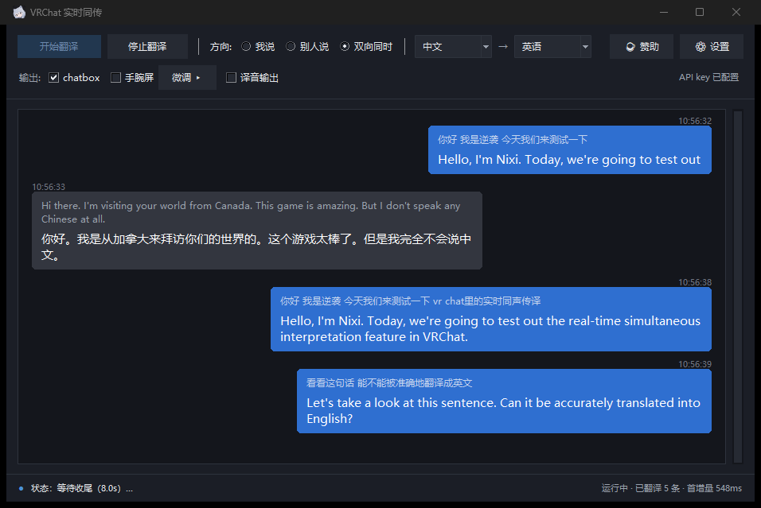

> [中文](../README.md) | [English](README.en.md) | [日本語](README.ja.md) | **한국어** | [Русский](README.ru.md)

# vrchat-livetranslate

> 📥 **중국 본토 직통 다운로드**（GitHub 없이 내려받기, 앱의 "업데이트 확인"도 같은 소스를 씁니다）：
> [Windows exe](https://dl.kcm-nixi.cn/VRChatLiveTranslate.exe) ·
> [Linux AppImage](https://dl.kcm-nixi.cn/VRChatLiveTranslate-x86_64.AppImage) ·
> [체크섬](https://dl.kcm-nixi.cn/SHA256SUMS.txt) ·
> [GitHub Releases](https://github.com/nixi-agent/vrchat-livetranslate/releases/latest)

VRChat 안에서 **실시간 동시 통역**을 해 주는 도구입니다: 마이크 / 게임 오디오를 캡처 →
Qwen Cloud 실시간 통역 모델로 전송 → 번역문을 **chatbox 말풍선**과
**VR 손목 오버레이**에 표시합니다. 선택적으로 번역 음성을 가상 사운드카드로 되돌려
**상대방이 바로 듣게** 할 수도 있습니다.

---

> 🧭 **이 문서에는 두 종류의 독자가 있습니다**
>
> - **exe만 받아 쓰는 분**: Python도, 명령줄도 필요 없습니다. `.venv\Scripts\python.exe`,
>   `run_*.bat`, `--xxx` 같은 것이 나오는 부분은 **모두 소스 설치 전용**이니 건너뛰세요.
>   필요한 기능은 GUI에 다 들어 있습니다.
> - **소스에서 실행하는 분**: 아래 내용이 모두 해당됩니다.

## Linux 관련

**Linux 버전도 있습니다** (Windows 10/11과 Linux 모두 지원. `config.yaml`은 공통이며 설정 의미도 동일합니다).

> 🐧 **Linux 사용자라면**: 설치와 사용법은 **[GUIDE.linux.md](GUIDE.linux.md)** 를 보세요.
> 다만 **이 문서는 영어와 중국어만 제공**되며, 한국어판은 아직 번역되지 않았습니다.
> 설계 근거(왜 WayVR을 쓰지 않는지, 어떤 방법이 안 되는지)는
> **[docs/平台约束记录.md](平台约束记录.md)** (중국어)에 정리되어 있습니다.

## 인터페이스 언어

UI는 **중국어 간체 / English / 日本語 / 한국어 / Русский** 다섯 가지 언어를 지원합니다.
기본값은 **Windows 표시 언어를 따라가며**, **⚙ 설정**에서 직접 바꿀 수 있습니다.
**변경 사항은 앱을 다시 시작한 뒤에 적용됩니다.**

## 할 수 있는 일

| 기능 | 상태 | 설명 |
|---|---|---|
| ① 내가 말함 → **chatbox 말풍선** | ✅ 구현됨, 기본 켜짐 | 마이크 → 엔드투엔드 음성 번역 → 첫 증분은 즉시 전송, 이후 2초마다 스냅샷, 문장 끝에는 반드시 최종본 전송 |
| ② 상대가 말함 → **VR 손목 오버레이** | ✅ 구현됨 | VRChat 재생 출력(WASAPI loopback)을 캡처 → 번역문(기본값은 중국어)으로 변환 → SteamVR 오버레이에 렌더링. **갱신이 있으면 즉시 화면에 표시** |
| ③ 내가 말함 → **번역 음성을 상대 귀에** | ✅ 구현됨, 기본 꺼짐 | 모델이 바로 출력한 번역 음성 → 48kHz로 리샘플링 → 가상 사운드카드에 기록 → VRChat 마이크로 입력됩니다. 가상 사운드카드(VoiceMeeter / VB-Cable 등)는 직접 준비하셔야 합니다. **「마이크 프록시」는 기본 켜짐**: 프로그램이 실행되는 동안 가상 사운드카드를 계속 점유하고, VRChat의 마이크는 그 장치로 고정되며, 메인 화면의 `🎙 원음` / `🗣 번역음` 버튼 하나로 상대가 듣게 될 것이 당신의 원음인지 번역음인지 한 번에 정합니다 |
| ④ 내가 말함 → **타이핑으로 대체** | ✅ 구현됨, 기본 켜짐 | 하단 입력창에서 **Enter로 전송**. 말하기 싫을 때 키보드로 대신할 수 있고, 번역문은 ①과 **완전히 같은** 경로(말풍선 / 손목 오버레이)를 탑니다. "번역 음성 출력"을 켜면 **TTS로 읽어서** 가상 사운드카드로 보내므로 상대방도 들을 수 있습니다 |
| ⑤ 여러 명 → **서로의 자막 보기(룸)** | ✅ 구현됨, 기본 꺼짐 | 각자 자기 프로그램을 실행하고 **같은 룸 코드**를 입력하면 각자의 손목 오버레이와 데스크톱 자막에 **상대방이 한 말**이 표시됨. 방송되는 것은 자기 발화뿐(게임 소리는 중계되지 않음). 입구: `⚙ 설정 → 룸` |

### 플랫폼 지원

| 기능 | Windows | Linux |
|---|---|---|
| ① chatbox 말풍선 | ✅ | ✅ |
| ② VR 손목 오버레이 | ✅ SteamVR overlay | ✅ 자체 OpenXR overlay (Monado / WiVRn) |
| ③ 번역 음성을 상대방에게 | ✅ 가상 사운드카드 필요(VoiceMeeter / VB-Cable) | ✅ **불필요** — 실행 시 프로그램이 직접 가상 마이크를 선언 |
| ④ 타이핑으로 대체(TTS 포함) | ✅ | ✅ |
| ⑤ 룸(서로의 자막 보기) | ✅ | ✅ |

---

---

## 📖 가이드

**가장 빠른 시작**부터 **알려진 제한**까지의 내용(설치, API key, 사용법, 설정,
문제 해결, 프로젝트 구조, 개발)은 별도 문서에 있습니다:

**➡️ [가이드(GUIDE.ko.md)](GUIDE.ko.md)**

---

## 🙏 위시 리스트 (Wishlist)

**하고 싶지만 제가 잘하지 못하거나, 방법을 모르거나, 직접 하기 싫은** 일들을 여기에 모아 둡니다.
"이건 내가 할 수 있겠는데" 싶은 항목이 있으면 **먼저 묻지 말고 그냥 시작하셔도 됩니다** ——
완성하면 issue나 PR로 알려 주세요. 이 아래에 여러분의 결과물을 걸어 두겠습니다.

> 📌 **이 목록은 계속 갱신됩니다.** 떠오르는 대로 추가하고, 끝난 항목은 내립니다
> (또는 ✅ 와 작성자 이름을 붙입니다). 새 항목을 놓치고 싶지 않다면 Star를 누르거나 가끔 들러 주세요.

- [ ] **① "어떻게 쓰는지" 알려 주는 튜토리얼 영상** — 만드는 사람 무관, **언어 무관**
      먼저 직접 앱을 설치하고 끝까지 한 번 돌려 보세요("0. 가장 빠른 시작" 절을 그대로 따라가면 됩니다).
      그다음 초보자용 튜토리얼을 녹화해 주세요: 다운로드와 설치 방법, API key를 어디에 붙이는지,
      VRChat 안에서 실제로 어떻게 쓰는지. 중국어 / English / 日本語 / 한국어 / Русский 어느 쪽이든 좋습니다.
      올리는 플랫폼, 길이, 스타일도 자유입니다.

- [ ] **② 스크린샷이 있는 글로 된 튜토리얼** — **언어 무관**
      역시 초보자를 대상으로, "다운로드부터 첫 번역 성공까지"의 흐름을 스크린샷과 글로 설명해 주세요.
      블로그 글, 문서 사이트, PDF, 긴 스레드 모두 괜찮습니다.

- [ ] **③ 모국어 화자의 UI 번역 검수** — 日本語 / 한국어 / Русский / English 원어민
      UI는 다섯 개 언어를 지원하지만, 일본어·한국어·러시아어 단어장은 기계 번역에
      비원어민인 제가 한 번 손본 것이 전부입니다 —— **자연스러움, 존댓말 일관성, 용어 통일은
      원어민만이 판단할 수 있습니다**. 방법은 간단합니다: UI를 쓰는 언어로 바꿔 평소처럼 써 보고,
      "번역이 틀렸다 / 어색하다 / 이해가 안 된다" 싶은 곳을 스크린샷과 함께 issue로 올려 주세요.
      직접 고치고 싶다면 `vlt/locales/<언어>.py` 가 "중국어 원문 → 해당 언어" 대응표이니,
      그 파일을 고쳐 PR을 보내면 됩니다. **코드는 건드리지 않습니다**.

완벽할 필요는 없습니다 —— 나중에 오는 사람이 함정 하나를 피할 수 있으면 성공입니다.

---

## ☕ 후원

**토큰 값을 도와주세요** 🙏

- ☕ **Ko-fi**(해외 / 신용카드 / PayPal):

  

- 중국 내: WeChat / Alipay로 스캔

- 🔑 아직 Qwen Cloud에 가입하지 않으셨다면 → **[Qwen Cloud 가입 ▸](https://www.qianwenai.com/)**

> GUI 상단 바에도 "☕ 후원" 버튼이 있으며 같은 링크를 엽니다.

---

## 라이선스

[MIT License](../LICENSE) © 2026 Nixi
